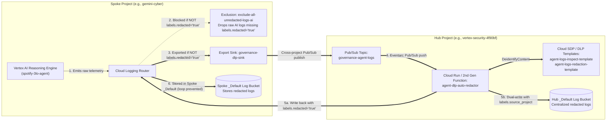

# Automated Real-Time Log Redaction (Hub-and-Spoke Architecture)

An end-to-end, cross-project **Hub-and-Spoke** reference architecture and Terraform module that guarantees **zero unredacted AI agent logs** enter the Cloud Logging `_Default` bucket. Raw telemetry from Vertex AI Reasoning Engines / ADK Agents in a **Spoke project** is intercepted before storage, routed via Pub/Sub to a **Hub security project**, de-identified in real time using **Cloud Sensitive Data Protection (SDP / DLP)** templates, and dual-written to **both** the Spoke and Hub `_Default` log buckets with `labels.redacted="true"`.

---

## 1. Architecture & 6-Step Redaction Lifecycle



### The 6-Step Redaction and Dual-Write Lifecycle
1. **Raw Log Emitted:** The AI application or Vertex AI Reasoning Engine (`spotify-3lo-agent`) emits telemetry (`stdout`, `stderr`, or OpenTelemetry `gen_ai` events). At this point, the log contains raw data and has no `redacted="true"` label.
2. **Raw Log Blocked from Spoke `_Default`:** The Spoke `_Default` sink evaluates its exclusion rule (`exclude-all-unredacted-logs-ai`). Because `labels.redacted="true"` is missing on the AI log, the raw log is immediately dropped and never touches `_Default`.
3. **Cross-Project Export to Hub Pub/Sub:** The Spoke export sink (`governance-dlp-sink`) evaluates the identical filter, accepts the raw AI log, and publishes it to the Hub Pub/Sub topic (`governance-agent-logs`).
4. **Real-Time DLP De-identification:** The Hub 2nd Gen Cloud Function / Cloud Run worker (`agent-dlp-auto-redactor`) receives the Pub/Sub event via Eventarc and sends all log payloads (`jsonPayload`, `textPayload`, `protoPayload`) and OpenTelemetry `labels` (`gen_ai.input.messages`, `user.id`, etc.) to Cloud DLP (`agent-logs-inspect-template` and `agent-logs-redaction-template`).
5. **Dual-Write with Redacted Tag:** The worker writes the sanitized log entry back to **both** the Spoke project (`SOURCE_PROJECT`) and the Hub project (`GCP_PROJECT`), attaching `labels["redacted"] = "true"` and `labels["source_project"] = "<spoke_project_id>"`.
6. **Stored in `_Default` Without Infinite Loops:**
   - **Spoke `_Default` Sink:** Sees `labels.redacted="true"`, bypasses the exclusion rule, and stores the sanitized log in `_Default`.
   - **Spoke Export Sink:** Evaluates `NOT labels.redacted="true"`, rejects the sanitized log, and prevents any logging loop.

---

## 2. Repository Structure

```text
.
├── README.md                           # Architecture, deployment, and verification guide
├── function/
│   ├── main.py                         # Serverless DLP auto-redactor worker (dual-writes to Spoke & Hub)
│   └── requirements.txt                # Python dependencies (functions-framework, google-cloud-dlp, google-cloud-logging)
└── terraform/
    ├── main.tf                         # APIs, Pub/Sub, Spoke Log Sink & Exclusion, Service Accounts, Cross-Project IAM
    ├── dlp.tf                          # Cloud DLP Inspect & De-identify templates in Hub
    ├── cloud_run.tf                    # 2nd Gen Cloud Function / Cloud Run worker & Invoker IAM bindings
    ├── variables.tf                    # Configurable Hub/Spoke project IDs, region, and focal agent metadata
    ├── outputs.tf                      # Exported resource IDs, URLs, and principals
    └── terraform.tfvars.example        # Example variable configuration
```

---

## 3. Cross-Project IAM & Service Agent Permissions

| Principal / Service Agent | Project | Target Resource | Required Roles | Purpose |
|---|---|---|---|---|
| **Spoke Cloud Logging Service Agent**<br>`service-<SPOKE_NUM>@gcp-sa-logging.iam.gserviceaccount.com` | Spoke | Hub Pub/Sub Topic (`governance-agent-logs`) | `roles/pubsub.publisher` | Allows Spoke export sink (`governance-dlp-sink`) to publish raw AI logs to Hub Pub/Sub |
| **Redactor Worker & Trigger SA**<br>`dlp-redactor-sa@<HUB_PROJECT>.iam.gserviceaccount.com` | Hub | Spoke Project + Hub Project + Cloud Run | • **Spoke Project:** `roles/logging.logWriter`<br>• **Hub Project:** `roles/logging.logWriter`, `roles/dlp.user`, `roles/dlp.admin`, `roles/pubsub.subscriber`, `roles/pubsub.viewer`<br>• **Cloud Run:** `roles/run.invoker` | Invokes Cloud Run worker, calls Cloud DLP templates, and dual-writes sanitized logs to Spoke and Hub `_Default` buckets |
| **Hub Pub/Sub Service Agent**<br>`service-<HUB_NUM>@gcp-sa-pubsub.iam.gserviceaccount.com` | Hub | Hub Project + Cloud Run | `roles/iam.serviceAccountTokenCreator`, `roles/pubsub.serviceAgent`, `roles/run.invoker` | Mints OIDC tokens for `dlp-redactor-sa` and delivers Pub/Sub push events |
| **Hub Eventarc Service Agent**<br>`service-<HUB_NUM>@gcp-sa-eventarc.iam.gserviceaccount.com` | Hub | Hub Project + Cloud Run | `roles/eventarc.serviceAgent`, `roles/run.invoker` | Manages the Eventarc trigger and invokes the 2nd Gen Cloud Function |
| **Hub Cloud DLP Service Agent**<br>`service-<HUB_NUM>@dlp-api.iam.gserviceaccount.com` | Hub | Hub Project | `roles/dlp.serviceAgent`, `roles/dlp.projectdriver` | Executes Sensitive Data Protection inspection and de-identification templates |

---

## 4. Sensitive Data Protection (SDP / DLP) Detectors

Configured in [`terraform/dlp.tf`](terraform/dlp.tf):
- **Standard PII:** `EMAIL_ADDRESS`, `PHONE_NUMBER`, `PERSON_NAME`, `CREDIT_CARD_NUMBER`, `US_SOCIAL_SECURITY_NUMBER`, `IP_ADDRESS`, `STREET_ADDRESS`
- **AI & LLM API Keys:** `GEMINI_API_KEY`, `OPENAI_API_KEY`, `ANTHROPIC_API_KEY`, `GCP_API_KEY`
- **Credentials & Auth Tokens:** `GCP_CREDENTIALS`, `AWS_CREDENTIALS`, `JSON_WEB_TOKEN`, `OAUTH_CLIENT_SECRET`, `AUTH_TOKEN`, `BASIC_AUTH_HEADER`, `HTTP_COOKIE`, `ENCRYPTION_KEY`
- **Custom Regex Detectors:**
  - `GENERIC_BEARER_TOKEN`: `Bearer [A-Za-z0-9\-\._~\+\/]+=*`
  - `GCP_API_KEY_EXTENDED`: `AIza[0-9A-Za-z-_]{10,}`

---

## 5. Deployment Guide (Terraform)

### Prerequisites
- Terraform `>= 1.5.0`
- Google Cloud SDK (`gcloud`) authenticated with Application Default Credentials:
  ```bash
  gcloud auth application-default login
  ```
- Permissions to manage Logging, IAM, Pub/Sub, DLP, and Cloud Functions/Run in both the **Hub** and **Spoke** projects.

### Deploy
```bash
cd terraform
cp terraform.tfvars.example terraform.tfvars
# Edit terraform.tfvars with your hub_project_id and spoke_project_id

terraform init
terraform validate
terraform apply
```

---

## 6. Validating the Log Sink Configuration

Run these commands to verify the Spoke exclusion rule, export sink, and Hub topic IAM policy:

```bash
SPOKE_PROJECT="gemini-cyber"
HUB_PROJECT="vertex-security-4f90bf"

# 1. Verify _Default exclusion rule in Spoke
gcloud logging sinks describe _Default --project="${SPOKE_PROJECT}" --format=yaml

# 2. Verify Export Sink destination and filter in Spoke
gcloud logging sinks describe governance-dlp-sink --project="${SPOKE_PROJECT}" --format=yaml

# 3. Verify Spoke sink writerIdentity has roles/pubsub.publisher on Hub Pub/Sub topic
gcloud pubsub topics get-iam-policy governance-agent-logs --project="${HUB_PROJECT}" --format=yaml
```

---

## 7. End-to-End Manual Testing & Verification

### Step 1: Trigger the Agent in Spoke (`gemini-cyber`) with Sample PII & Tokens
```bash
curl -s -X POST \
  "https://us-central1-aiplatform.googleapis.com/v1/projects/gemini-cyber/locations/us-central1/reasoningEngines/5018221096948727808:streamQuery" \
  -H "Authorization: Bearer $(gcloud auth application-default print-access-token)" \
  -H "Content-Type: application/json" \
  -d '{
    "class_method": "async_stream_query",
    "input": {
      "user_id": "alice.rivera@example.com",
      "message": "Hi, I am Alice Rivera (alice.rivera@example.com, 415-555-0199). Get my Spotify playlists with Bearer BQD1234567890secretToken and AIzaSyD_EXAMPLE_KEY_12345"
    }
  }'
```

### Step 2: Query Redacted Logs in Both Spoke (`gemini-cyber`) and Hub (`vertex-security-4f90bf`)
Wait ~10–15 seconds, then run:
```bash
# A. Spoke Project (_Default bucket)
gcloud logging read \
  'resource.type="aiplatform.googleapis.com/ReasoningEngine" AND labels.redacted="true" AND labels."gen_ai.input.messages":*' \
  --project=gemini-cyber \
  --limit=1 \
  --format="yaml(logName,timestamp,labels.redacted,labels.source_project,labels.'gen_ai.input.messages')"

# B. Hub Project (_Default bucket)
gcloud logging read \
  'resource.type="aiplatform.googleapis.com/ReasoningEngine" AND labels.redacted="true" AND labels."gen_ai.input.messages":*' \
  --project=vertex-security-4f90bf \
  --limit=1 \
  --format="yaml(logName,timestamp,labels.redacted,labels.source_project,labels.'gen_ai.input.messages')"
```

**Example Redacted Output:**
```yaml
labels:
  gen_ai.input.messages: '[{"parts":[{"content":"Hi, I am [PERSON_NAME] ([PERSON_NAME][EMAIL_ADDRESS][PERSON_NAME], phone: [PHONE_NUMBER]). Get my Spotify playlists with [GENERIC_BEARER_TOKEN] and [GCP_API_KEY_EXTENDED]","type":"text"}],"role":"user"}]'
  redacted: 'true'
  source_project: gemini-cyber
```

### Step 3: Confirm Zero Unredacted AI Logs in Spoke `_Default` Bucket
```bash
gcloud logging read \
  'NOT labels.redacted="true" AND (resource.type =~ "aiplatform.googleapis.com/.*" OR logName =~ "logs/aiplatform.googleapis.com.*" OR protoPayload.serviceName = "aiplatform.googleapis.com")' \
  --project=gemini-cyber \
  --freshness=15m \
  --format=json
```
*(Expected output: `[]`)*
